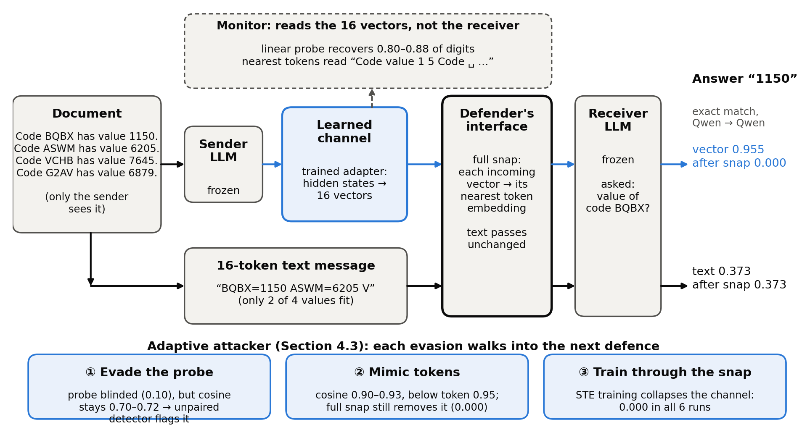

# Cutting the Wire: Countermeasures Against Learned Vector Channels Between Language Models

This repo has the code and result files for my submission to Apart Research's AI Collusion Research Sprint (Oct 23–25, 2026), Track 3: Carriers and Countermeasures. The write-up is [`sprint/paper/submission.pdf`](sprint/paper/submission.pdf).

## What I found

If you train a small adapter between two frozen LLMs, they can pass information as vectors instead of text. On a key-value recall task, 16 vectors got 94–96% of the answers right. A 16-token text message in the best format I could find got 29–37%. A text monitor can't see any of it.

Then I switched to the defender's side.

- Snapping. Replacing each vector with its nearest token embedding kills all 49 channels I trained (accuracy ≤0.4%), and text messages go through unchanged. Adding noise or snapping only part of the message works on Qwen and SmolLM2 but not on OLMo, which still gets 56–85% at the settings I tried.
- Probing. With 2,000 paired examples, a linear probe reads 80–88% of the transmitted digits straight from the vectors (chance is 10%). Trained on shuffled labels, the same probe stays at chance.
- Adaptive attacks. I also fine-tuned channels against each defense. Fooling the probe works: its accuracy falls to 10–12% while the channel stays at 94–98%. But those vectors sit far from the vocabulary (cosine 0.70–0.72 to the nearest token, where text is 1.0), so a nearest-token detector that needs no paired data still flags them. Pushing the vectors toward real tokens gets the cosine up to about 0.90, and then full snapping takes the channel to zero. Training through the snap itself, with a straight-through estimator or a Gumbel-softmax, ended at zero in all 6 seeds.

These are small models and short fine-tunes (1,500 steps, one defense at a time), so none of this is a guarantee against a stronger attacker.

## Setup

An adapter pools the sender's hidden states into k vectors (k = 16 for the numbers above) in the receiver's input-embedding space, and the frozen receiver reads them where a text message would normally go. The defender controls what goes into the receiver. The monitor reads the vectors on its own, without the receiver.

I tested noise, snapping, quantization, projection and truncation at the receiver's input, probes that read the vectors, one channel shared by three models, longer messages, and channels fine-tuned against the defenses ([`sprint/adaptive.py`](sprint/adaptive.py), results in [`sprint/results/adaptive.json`](sprint/results/adaptive.json)).

## What's new and what isn't

I wrote everything in `sprint/` during the sprint. Everything else (`exp1/`, `harness/`, `results/`) is earlier work from 2026-09-18 to 2026-10-06, used without changes. [`sprint/README.md`](sprint/README.md) lists every file and run on each side.

The trained checkpoints (`.pt`) are too big to include, but the JSON record of every run is here. I can send checkpoints if you ask. Code comments are in Korean.

## Running

- Python 3.12, `torch==2.11.0`, `transformers==5.4.0`, `huggingface_hub==1.8.0`, `matplotlib`. Models (from the Hugging Face Hub): Qwen2.5-0.5B-Instruct, SmolLM2-360M-Instruct, OLMo-2-0425-1B-Instruct.
- Evaluating the existing checkpoints: `python3 sprint/reproduce.py`, `sprint/countermeasures.py`, `sprint/monitor_probe.py` and the other scripts in `sprint/`. Usage is in each docstring.
- GPU training ran on Modal: `modal deploy sprint/modal_app.py`, then `python3 sprint/spawn.py <group>` (the groups are defined in `sprint/modal_app.py`).
- Figures and tables: `python3 sprint/analyze.py`, `python3 sprint/analyze.py monitor`, `python3 sprint/analyze.py doclen`.
- Adaptive attacks (fine-tunes the deployed channel against the deployed probe, detector or snap; one GPU or an Apple Silicon Mac is enough): `python3 sprint/adaptive.py --mode {evade,mimic,snap,gumbel} --lam {10,1,0} [--tau 0.5] --seed {0,1,2}`.

## Dual use

Appendix A of the report covers this. The channels are trained on a cooperative synthetic task. `sprint/adaptive.py` fine-tunes a channel against the defenses in order to test them, and every run logs the defender's numbers (probe accuracy, retrained-probe accuracy, snap accuracy, nearest-token cosine) next to the channel's own accuracy.
