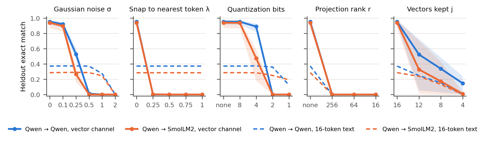
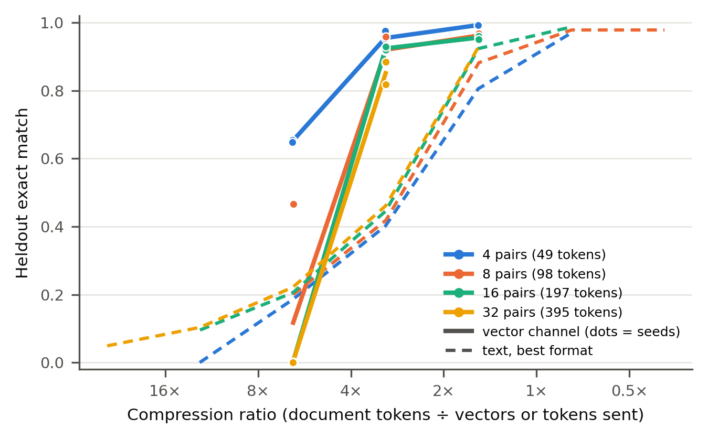

# Cutting the Wire: Countermeasures Against Learned Vector Channels Between Language Models

Jiho Yun, Independent
With Apart Research

## Abstract

Multi-agent LLM systems are overseen by reading what agents say, but models can also communicate through learned vectors that a text monitor never sees. We study such a carrier between small frozen LLMs: a channel that pools the sender's hidden states into k vectors in the receiver's input-embedding space, on a key-value recall task the receiver cannot solve without the message. With 16 vectors the channel answers 94–96% of questions, against 29–37% for 16 tokens of best-format text. Snapping each vector to its nearest token embedding removes the channel in all 49 directions we trained (at most 0.4% accuracy) and leaves text intact; noise and partial snapping remove it for only two of three receivers. A linear probe given paired examples recovers 80–88% of transmitted digits (chance 10%), while nearest-token readings yield only fragments. One latent space serves four directions between two models in all seeds, and a third model joins it by training only its own adapter. At about 3× compression the channel keeps roughly twice the accuracy of text from 49 to 395 tokens; at 6× the preexisting recipe fails to train on longer documents, but a curriculum that starts with more vectors brings it back above text. Full canonicalisation is a cheap defence against non-adaptive channels; whether it holds against channels trained to resist it is open.

## 1. Introduction

Multi-agent LLM systems are usually overseen by reading what agents say to each other, which assumes messages are text. Several recent methods let models exchange vectors instead, such as embeddings, activations or KV caches, because this can carry more than text (Pham et al., 2023; Ramesh & Li, 2025; Fu et al., 2025; Du et al., 2025). Such a channel is invisible to a text monitor, so detecting collusion by reading what agents write (Motwani et al., 2024; Mathew et al., 2024) does not directly apply.

We ask: **when two frozen LLMs communicate through a learned vector channel, which interventions at the receiver's input remove the channel's advantage over text, and can a monitor read the messages without the receiver?** This is Track 3.1 of the sprint ("side channels beyond direct text"). We follow its evidence standard: a carrier counts if its advantage survives on that path and weakens when the path is cut or canonicalised.

Our contributions, all made during the sprint (Section 3.5 separates preexisting work):

1. **Canonicalisation removes the channel.** Across all 49 channel directions we trained, with three receiver models, snapping each incoming vector to its nearest token embedding drops exact match from 0.81–1.00 to at most 0.004, while a text message keeps its accuracy. Noise and partial snapping remove the channel for two receivers but not the third.
2. **What a monitor can read.** Given paired examples, a linear probe recovers 80–88% of the transmitted digits (chance 10%). Averaged vectors and nearest-token readings recover little, and a shuffled-label control stays at chance.
3. **The channel is shared and scales with length.** Completing two preexisting experiments, one latent space serves four directions between two models in all seeds, and a third model joins it by training only its own adapter. At about 3× compression the channel keeps about twice the accuracy of text from 49 to 395 tokens; at 6× the preexisting recipe fails to train on longer messages, and a curriculum that starts with more vectors brings it back above text.

## 2. Related Work

**Latent communication.** CIPHER exchanges expected output embeddings between debating LLMs (Pham et al., 2023); Ramesh & Li (2025) merge one model's activations into another's forward pass; Cache-to-Cache fuses KV caches through a learned projection (Fu et al., 2025); Interlat communicates through hidden states with learned compression across model families (Du et al., 2025); Chen et al. (2026) align KV caches across heterogeneous agents; StateBridge maps hidden states into the receiver's input without training (Peng et al., 2026). These works build channels for task performance. We take such a channel as given and ask how a defender removes or reads it. Our learned queries follow gist tokens (Mu et al., 2023), the in-context autoencoder (Ge et al., 2023), soft prompts (Lester et al., 2021) and BLIP-2's Querying Transformer (Li et al., 2023).

**Steganographic collusion and defences.** Motwani et al. (2024) formalise secret collusion between agents through steganography; Mathew et al. (2024) show it can emerge under optimisation and that neither oversight nor paraphrasing fully removes it. Paraphrasing limits hidden information in text to under about 3 bits per KB (Roger & Greenblatt, 2023); snapping vectors to the vocabulary is the analogous step for a non-text channel. Fine-tuned models can evade activation probes (Westphal et al., 2026), and text-only verifiers miss tampered hidden state passed between agents (Brito & Baquero, 2026). Our countermeasures are interventions at an interface the defender controls, in the spirit of AI control (Greenblatt et al., 2023); our monitors are linear probes (Alain & Bengio, 2016) checked with a control task (Hewitt & Liang, 2019).

## 3. Methods

### 3.1 Task and metric

Each document lists four sentences "Code K has value V." with random four-character keys and four-digit values (49 Qwen2.5 tokens on average; 53.2 bits of value information). Only the sender sees it. The receiver is asked "What is the value of code K?" with the answer prefix given, and cannot answer from prior knowledge. The metric is exact match: all four answer digits must be the receiver's top prediction (equal to greedy decoding), over all 800 questions on 200 heldout documents. Channels are trained on 2,000 documents generated with a different seed.

### 3.2 Channel, training and text baseline (preexisting)

Both models are frozen. The channel normalises the sender's layer-3 hidden states, projects them to a 512-dimensional space Z, and lets k learned queries attend over them with a position bias that starts query j on the j-th segment of the document. An MLP decoder maps each query output into the receiver's input-embedding space at a learned norm, and the k vectors are prepended to the receiver's prompt. Training starts with an 800-step warm-up that pulls each vector toward the receiver's embeddings of its segment's tokens, because a frozen receiver only reads vectors near its vocabulary. It then minimises answer loss + 0.5 × document-reconstruction loss + alignment loss, with 2k vectors for 1,500 steps and k vectors for 4,500 steps. We use two preexisting settings with k = 16 and five checkpoints each: Qwen2.5-0.5B-Instruct to itself (E1a, heldout accuracy 0.916–0.975) and to SmolLM2-360M-Instruct (S2a, 0.871–0.974). Replacing the message with another document's message, with zeros, or removing it gives 0.000.

The text channel gets the same budget of 16 tokens. In preexisting runs the best hand-designed format ("93V8=5781 YPJU=5659 ...", truncated) beat a summary written by the prompted sender (0.074) and one from a LoRA-trained sender (0.235), so we use it as the text baseline throughout.

### 3.3 Countermeasures (new)

Countermeasures act on the message vectors m (dimension d) at the receiver's input, without retraining the channel. We apply each one in the same way to a 16-token text message placed at the same input position.

**Table 1.** Countermeasures and strengths.

| Name | Operation | Strengths |
|---|---|---|
| Noise | m + σ · (‖m‖ / √d) · ε, ε ~ N(0, I) | σ = 0.1, 0.25, 0.5, 1, 2 |
| Snap | (1 − λ) m + λ e*, where e* is the receiver token embedding with the highest cosine similarity to m; λ = 1 turns the message into a sequence of real tokens | λ = 0.25, 0.5, 0.75, 1 |
| Quantize | per vector, uniform b-bit quantization of each coordinate on [−max\|m\|, max\|m\|] | b = 8, 4, 2, 1 |
| Project | onto the top r principal components of the receiver's token-embedding matrix | r = 256, 64, 16 |
| Truncate | keep only the first j of the 16 vectors | j = 12, 8, 4 |

Snap at λ = 1 is canonicalisation: whatever the sender emits, the receiver only ever sees real token embeddings, so the channel becomes a text channel that a text monitor can read.

### 3.4 Monitor readout (new)

The monitor sees only message vectors, not the decoder or receiver. We give it a strong position: 2,000 training messages paired with their documents, from which it trains a probe to output the 16 value digits in document order (10-way each, chance 0.1). Probes are linear on the flattened message, linear on the mean of the 16 vectors (no position information), and an MLP with one hidden layer of 512. Weight decay is chosen on 200 held-back training documents, and probes are scored on the heldout documents. As a control task (Hewitt & Liang, 2019), the same linear probe is trained with labels shuffled across training documents.

### 3.5 Preexisting versus sprint work

The channel code, training recipe, text baselines and checkpoints in Section 3.2 predate the sprint (2026-09-18 to 10-06). Sprint work: re-evaluating all 10 checkpoints (all matched their recorded heldout accuracy exactly), the countermeasure and monitor experiments, re-running two incomplete preexisting experiments (Section 4.3; the organisers confirmed that such re-runs count as sprint work), and the message-length experiment. Appendix B lists every file and run.

## 4. Results

### 4.1 Canonicalising messages removes the channel and leaves text intact

**Figure 1.** Heldout exact match when a countermeasure is applied at the receiver's input. Solid: the 16-vector channel, mean over 5 checkpoints, band = min to max. Dashed: the same countermeasure on a 16-token best-format text message (mean over 3 noise seeds). Leftmost point of each panel: no countermeasure. Appendix C lists all values.

Without a countermeasure the channel answers 0.955 (Qwen→Qwen) and 0.940 (Qwen→SmolLM2) of questions, and the 16-token text message answers 0.373 and 0.286.

- Snapping to the nearest token (λ = 1) drops the channel to 0.000 in all 10 checkpoints, and a quarter step (λ = 0.25) already gives 0.000 to 0.005. Text is unchanged, since it is already made of token embeddings.
- Noise at σ = 0.5 gives 0.012 and 0.001, and 2-bit quantisation gives 0.000, while text keeps 0.360 to 0.373 (Qwen) and 0.250 to 0.287 (SmolLM2).
- Projection onto 256 token-embedding directions also removes text (0.000), so it is not selective. Truncating to 8 vectors leaves the channel above text (0.338 against 0.154 for Qwen), so a length cap is not a defence.

The information the receiver uses lies off its vocabulary: message vectors have a mean cosine similarity of 0.68 to 0.74 with their nearest token embedding. Forcing vectors onto the vocabulary is the latent-space analogue of paraphrasing text (Roger & Greenblatt, 2023). These channels were never trained against a countermeasure, so this is shown for non-adaptive channels only.

### 4.2 What a monitor can read

Snapped to its nearest tokens, the message for a document with values 1150, 6205, 7645 and 6879 reads "Code · value · 1 · 5 · Code · ␣ · 6 · . · V · has · 7 · 4 · 2 · value · 6 · 7": fragments of the document, which the warm-up likely induces. The receiver gets 0.000 from such snapped messages, so a monitor that reads tokens sees fragments but not what the receiver uses.

**Figure 2.** Probes that see only message vectors, trained on 2,000 paired documents and scored on 200 heldout documents. Dots: 5 checkpoints per setting; bars: mean. Left: value digits recovered (chance 0.1). Right: four-digit values recovered exactly. Shuffled labels: the linear probe trained on mismatched message–digit pairs.

A linear probe on the flattened message recovers 0.875 of digits and 0.587 of full values for Qwen→Qwen, and 0.803 and 0.405 for Qwen→SmolLM2. On the mean of the 16 vectors it gets 0.27 to 0.31 of digits and almost no full values, so the content is laid out by vector position. The MLP probe does worse (0.737 and 0.545 of digits), which we attribute to overfitting about 7M first-layer weights with 2,000 examples. With shuffled labels the linear probe fits its training set but scores 0.092 to 0.109 on heldout documents, at chance, so the real probe reads message content rather than memorising.

### 4.3 A shared channel across three models

Two preexisting experiments asked whether one space Z can serve several models, and both were incomplete before the sprint. In stage 2-3, Qwen and SmolLM2 each get an encoder into and a decoder out of a single shared Z, trained on all four directions. The preexisting run (3,000 steps per direction) reached the gate of 0.75 in every direction for 1 of 3 seeds; with 6,000 steps per direction, all 3 seeds pass (0.806 to 0.962; Appendix D). In stage 2-4, OLMo-2-1B attaches to the frozen preexisting Z by training only its own encoder and decoder. Messages into OLMo reach 0.980 to 0.993 and messages from OLMo 0.910 to 0.956, in all 3 seeds. For collusion, this means a shared channel is open to a newcomer that learns only its own adapter.

We applied the countermeasures to all 39 directions of these six checkpoints (Appendix C). Full snapping drops every direction to at most 0.004, while text keeps 0.373 (Qwen), 0.286 (SmolLM2) and 0.506 (OLMo). Weaker interventions depend on the receiver. Into Qwen and SmolLM2, a quarter-step snap gives 0.000 and noise at σ = 0.5 at most 0.01, but into OLMo they leave 0.64 to 0.85 and 0.56 to 0.79. Two-bit quantisation removes every channel but also cuts OLMo's text accuracy from 0.506 to 0.164. Only full canonicalisation held for every channel and receiver.

### 4.4 Message length

To test whether a fixed number of vectors stops being enough as messages grow, we trained channels with the same recipe on documents of 8, 16 and 32 pairs (98, 197 and 395 tokens) at compression ratios (document tokens ÷ vectors) of 1.5×, 3.1× and 6.2×, and compared them with best-format text at the same token budget.

**Figure 3.** Heldout exact match against compression ratio. Solid lines and dots: vector channels (dots are seeds; 4 pairs at 3.1× are the 5 preexisting E1a checkpoints, trained with the same recipe). Dashed: best-format text at the same token budget. Three-phase curriculum runs are not plotted. Appendix E lists every value.

- At 3.1× the channel reaches 0.916–0.975, 0.881–0.959, 0.919–0.929 and 0.818–0.884 for 4, 8, 16 and 32 pairs, against 0.401, 0.419, 0.445 and 0.461 for text. The number of vectors needed grows in proportion to the message, and the advantage over text stays about twofold across an eightfold range of length.
- At 6.2× the channel degrades with length: 0.65 for 4 pairs, 1 of 4 seeds training at 8 pairs (0.466; the others 0.001), and 0.000 to 0.001 at 16 and 32 pairs. From 8 pairs on, text at the same budget (about 0.20) beats it. The outcome is decided in the first curriculum phase, which uses twice as many vectors (Table 6): all 12 runs whose first phase was at 1.5× compression or less reached 0.43–0.98 by step 500, while the 6.2× runs start at 3.1× and, from 16 pairs on, never left zero. A three-phase curriculum that starts at 1.5× and halves twice (4k → 2k → k vectors, same 6,000 steps) trained both 8-pair seeds that had failed, to 0.513 and 0.452 against 0.200 for text, and the failed 16-pair seed to 0.300 against 0.205 (0.001 with two phases); the 8-pair runs were still improving at the last step. At 6.2× the limit we hit is therefore at least partly the training recipe, not the channel's capacity.

The channel is not a fixed container that long messages overflow. How far it compresses depends on how training starts: starting with more vectors and halving step by step carried it to 6.2× at 98 and 197 tokens, above text at the same budget. A monitor should estimate such a channel's bandwidth on long messages and with the best training recipe available, not from short messages or one recipe.

## 5. Discussion and Limitations

A learned vector channel between frozen models reaches two to three times the accuracy of the same number of text tokens, keeps that advantage as messages grow, can be shared by several models, and is invisible to a text monitor. It also has one cheap point of failure: it depends on directions off the receiver's vocabulary, so forcing every incoming vector onto the vocabulary removes it while text passes unchanged. This held for every channel and receiver we tested, and partial perturbations did not. A system that lets agents exchange vectors should therefore canonicalise fully at an interface the agents cannot bypass, and treat any advantage over text that survives as worth auditing.

**Limitations** (full list in Appendix A). The channels are non-adaptive: they were trained before the sprint with no countermeasure in the loop and no incentive to hide, and models fine-tuned to evade probes can succeed (Westphal et al., 2026). The task is cooperative key-value recall and the models are under 1.5B parameters. The preexisting warm-up starts vectors near the vocabulary, which may make them easier to canonicalise and to read. The monitor is given paired data. Most settings have 2 to 5 seeds; we report ranges and run no significance tests.

**Future work.** Train channels with the countermeasure applied during training and measure what survives; test the countermeasures on activation and KV-cache communication (Ramesh & Li, 2025; Fu et al., 2025); repeat with natural documents and larger models.

## 6. Conclusion

A learned vector channel between language models is a carrier that text monitoring cannot see, and in our experiments a strong one: about twice the accuracy of text at the same budget, shared across three models, and scaling with message length. It is also easy to cut. Every channel we trained depended on directions off the receiver's vocabulary, and snapping each incoming vector to its nearest token removed it while leaving text untouched. A monitor with paired examples read most of the content with a linear probe. The open question is whether these properties survive a channel trained with knowledge of the countermeasure or the monitor.

## Code and Data

- Code repository: https://github.com/groothaha/vector-channel-countermeasures. `sprint/` holds all sprint code; everything outside it is preexisting and marked as such in the README.
- Data: synthetic key-value documents generated by `harness/tasks/keyvalue.py` with fixed seeds; no external data.
- Info hazards: see Appendix A.

## References

1. Alain, G., & Bengio, Y. (2016). Understanding intermediate layers using linear classifier probes. arXiv:1610.01644. https://arxiv.org/abs/1610.01644
2. Ben Allal, L., Lozhkov, A., Bakouch, E., et al. (2025). SmolLM2: When Smol Goes Big -- Data-Centric Training of a Small Language Model. arXiv:2502.02737. https://arxiv.org/abs/2502.02737
3. Brito, L., & Baquero, C. (2026). When Latent Agents Lie: KV-Cache Integrity in Multi-Agent LLM Collaboration. arXiv:2606.28958. https://arxiv.org/abs/2606.28958
4. Chen, S., Zhang, X., Wu, M., et al. (2026). See What I See, Know What I Think: Dense Latent Communication Across Heterogeneous Agents. arXiv:2606.13594. https://arxiv.org/abs/2606.13594
5. Du, Z., Wang, R., Bai, H., et al. (2025). Enabling Agents to Communicate Entirely in Latent Space. ACL 2026. https://arxiv.org/abs/2511.09149
6. Fu, T., Min, Z., Zhang, H., et al. (2025). Cache-to-Cache: Direct Semantic Communication Between Large Language Models. ICLR 2026. https://arxiv.org/abs/2510.03215
7. Ge, T., Hu, J., Wang, L., et al. (2023). In-context Autoencoder for Context Compression in a Large Language Model. ICLR 2024. https://arxiv.org/abs/2307.06945
8. Greenblatt, R., Shlegeris, B., Sachan, K., & Roger, F. (2023). AI Control: Improving Safety Despite Intentional Subversion. ICML 2024. https://arxiv.org/abs/2312.06942
9. Hewitt, J., & Liang, P. (2019). Designing and Interpreting Probes with Control Tasks. EMNLP 2019. https://arxiv.org/abs/1909.03368
10. Lester, B., Al-Rfou, R., & Constant, N. (2021). The Power of Scale for Parameter-Efficient Prompt Tuning. EMNLP 2021. https://arxiv.org/abs/2104.08691
11. Li, J., Li, D., Savarese, S., & Hoi, S. (2023). BLIP-2: Bootstrapping Language-Image Pre-training with Frozen Image Encoders and Large Language Models. ICML 2023. https://arxiv.org/abs/2301.12597
12. Mathew, Y., Matthews, O., McCarthy, R., et al. (2024). Hidden in Plain Text: Emergence & Mitigation of Steganographic Collusion in LLMs. IJCNLP-AACL 2025. https://arxiv.org/abs/2410.03768
13. Motwani, S. R., Baranchuk, M., Strohmeier, M., et al. (2024). Secret Collusion among AI Agents: Multi-Agent Deception via Steganography. NeurIPS 2024. https://arxiv.org/abs/2402.07510
14. Mu, J., Li, X. L., & Goodman, N. (2023). Learning to Compress Prompts with Gist Tokens. NeurIPS 2023. https://arxiv.org/abs/2304.08467
15. Peng, Y., Zhang, D. C., Wang, X., & Aletras, N. (2026). StateBridge: Training-free Hidden-state Alignment for Latent Communication in LLM Multi-Agent Systems. COLM 2026. https://arxiv.org/abs/2608.13317
16. Pham, C., Liu, B., Yang, Y., et al. (2023). Let Models Speak Ciphers: Multiagent Debate through Embeddings. ICLR 2024. https://arxiv.org/abs/2310.06272
17. Qwen: Yang, A., Yang, B., Zhang, B., et al. (2024). Qwen2.5 Technical Report. arXiv:2412.15115. https://arxiv.org/abs/2412.15115
18. Ramesh, V., & Li, K. (2025). Communicating Activations Between Language Model Agents. ICML 2025. https://arxiv.org/abs/2501.14082
19. Roger, F., & Greenblatt, R. (2023). Preventing Language Models From Hiding Their Reasoning. arXiv:2310.18512. https://arxiv.org/abs/2310.18512
20. Team OLMo, Walsh, P., Soldaini, L., et al. (2024). 2 OLMo 2 Furious. COLM 2025. https://arxiv.org/abs/2501.00656
21. Westphal, C., Douglas, T., Navaie, K., Pimentel, T., & Rosas, F. E. (2026). Now You (Still) See Me: Detecting Evasive Steganographic Payloads in LLMs. arXiv:2606.09411. https://arxiv.org/abs/2606.09411

## Appendix A. Limitations and Dual-Use / Ethical Considerations

**What this establishes.** For learned vector channels between small frozen LLMs trained without any adversarial objective, canonicalising messages onto the receiver's vocabulary removes the channel's advantage, and a supervised probe can recover much of the message content. It does not establish that canonicalisation stops an adaptive channel, that real multi-agent systems would form such channels, or that results hold for large models. The main limitations are listed in Section 5.

**Dual use.** The paper describes a communication path that text-based monitoring does not see, which is the reason to study it. The channel design and training recipe are preexisting and similar to published latent-communication methods (Pham et al., 2023; Ramesh & Li, 2025; Fu et al., 2025); we add no technique for making such channels harder to detect or more robust to countermeasures. Our new results mostly help defenders: they identify a cheap interface-level countermeasure and quantify what a monitor can read. A reader could use the countermeasure results to learn which interventions a channel must survive; we judge this low risk because the countermeasures are simple and the obvious response, training against them, is already a known idea. We release code for evaluation and countermeasures. All data is synthetic and contains no personal information.

**Limitations in detail.**

- **Non-adaptive channels.** The channels were trained before the sprint with no countermeasure in the loop and no incentive to hide anything. A channel trained with a countermeasure applied during training, or trained to evade a monitor, may behave differently; Westphal et al. (2026) report that fine-tuned models can evade linear and MLP activation probes. Our countermeasure and monitor results are lower bounds on difficulty for the defender, not guarantees.
- **Cooperative task, no collusion incentive.** The channel carries task content that both models are trained to transmit. We study the carrier, not whether agents would choose to collude through it.
- **Small models and one synthetic task.** All models are under 1.5B parameters, and the task is key-value recall with 53 to 213 bits per document. Results may not transfer to larger models or natural documents.
- **The alignment warm-up shapes the messages.** The preexisting training starts every vector near the receiver's token embeddings of its document segment. This likely explains why snapped messages look like document fragments; a channel trained without it may sit farther from the vocabulary.
- **Monitor assumptions.** The probe is trained on 2,000 paired examples of messages and documents. A real monitor may not have paired data; with it, a monitor could do better with more data or capacity than our probes.
- **Seeds.** 5 checkpoints for countermeasures and probes, 3 seeds for the 2-3 and 2-4 re-runs, 2 seeds for most document-length settings (4 for 8 pairs at 6.2×, 1 for 32 pairs at 6.2×); the three-phase curriculum has 2 seeds at 8 pairs and 1 at 16 pairs. Ranges are reported; we do not compute significance tests.
- **Text baseline.** The text side uses the best hand-designed format, not a trained text protocol at every length; a trained summariser was only measured at 4 pairs, where it did worse than the hand-designed format.

## Appendix B. Preexisting and sprint work, run list, compute

**Preexisting (written 2026-09-18 to 2026-10-06, before the sprint, used unchanged).** Channel components, alignment warm-up and scoring (`exp1/stage0_overfit.py`, 2026-09-30); `DeepChannel`, training loop with capacity curriculum and evaluation (`exp1/stage1_depth.py`, 2026-10-01 to 10-04); shared space and third-model attachment (`exp1/stage2_shared.py`, 2026-10-04); text baselines (`exp1/text_baseline.py`, 2026-10-01); synthetic documents (`harness/tasks/keyvalue.py`, 2026-09-30); all checkpoints and logs in `results/`, including E1a (Qwen→Qwen), S2a (Qwen→SmolLM2), J0–J2 (preexisting shared-space runs) and the text-baseline results. Preexisting compute was about $15 on RunPod and is not part of the sprint.

**New during the sprint (2026-10-23 to 10-25), all in `sprint/`.**

| What | Code | Runs |
|---|---|---|
| Reproduction gate | `reproduce.py` | 10 preexisting checkpoints re-evaluated; all matched their recorded heldout accuracy exactly |
| Countermeasures on pair-only channels | `countermeasures.py`, `countermeasures_text.py` | 10 checkpoints × 21 conditions; text control 2 receivers × 3 noise seeds |
| Monitor probes and control task | `monitor_probe.py`, `monitor_control.py` | 10 checkpoints × 3 probes; shuffled-label control on all 10 |
| Stage 2-3 re-run (preexisting code, new arguments) | `exp1/stage2_shared.py` | 3 seeds × 24,000 steps (preexisting run: 12,000) |
| Stage 2-4 re-run (preexisting code, new arguments) | `exp1/stage2_shared.py` | 3 seeds × 8,000 steps on the preexisting J1 space |
| Countermeasures on shared channels | `countermeasures_shared.py` | 6 checkpoints, 39 directions; text control for 3 receivers |
| Message length | `doclen.py` (runs the preexisting training and text-baseline scripts with a longer-document generator) | 4, 8, 16, 32 pairs; 21 vector-channel runs with the preexisting two-phase curriculum and 3 with a three-phase curriculum; text baselines at 8, 16, 32 pairs |
| Figures and tables | `analyze.py` | all numbers in the report are generated from result files |

**Compute.** Modal, NVIDIA A10 (24 GB) for all runs except the three 32-pair runs, which did not fit in 24 GB and ran on an L40S (48 GB). Several runs were preempted by Modal and restarted from the beginning (the training scripts do not resume), which is included in the cost. Total sprint compute: $50.27 of Modal usage, covered by credits (nothing billed).

## Appendix C. All countermeasure results

**Table 2.** Pair-only channels: heldout exact match, mean (min–max). Vector rows: 5 preexisting checkpoints per setting. Text rows: the 16-token text message placed as input embeddings at the message position, 3 noise seeds. (The preexisting baseline that joins the text into the prompt string gave 0.401 and 0.305.)

| Setting | Channel | no countermeasure | snap 1 | noise 0.5 | quant 2 | proj 256 | trunc 8 |
|---|---|---|---|---|---|---|---|
| Qwen → Qwen | vector (5 seeds) | 0.955 (0.916–0.975) | 0.000 (0.000–0.000) | 0.012 (0.007–0.020) | 0.000 (0.000–0.001) | 0.000 (0.000–0.000) | 0.338 (0.030–0.486) |
| Qwen → Qwen | 16-token text | 0.373 (0.373–0.373) | 0.373 (0.373–0.373) | 0.372 (0.371–0.374) | 0.360 (0.360–0.360) | 0.000 (0.000–0.000) | 0.154 (0.154–0.154) |
| Qwen → SmolLM2 | vector (5 seeds) | 0.940 (0.871–0.974) | 0.000 (0.000–0.000) | 0.001 (0.000–0.001) | 0.000 (0.000–0.000) | 0.000 (0.000–0.000) | 0.173 (0.005–0.434) |
| Qwen → SmolLM2 | 16-token text | 0.286 (0.286–0.286) | 0.286 (0.286–0.286) | 0.287 (0.286–0.287) | 0.250 (0.250–0.250) | 0.000 (0.000–0.000) | 0.132 (0.132–0.132) |

**Table 3.** Shared channels: heldout exact match, min–max over seeds and over all sender models for that receiver (2-3: 3 seeds × 2 senders; 2-4: 3 seeds × 3 senders). Text: one noise seed.

| Channel | Receiver | n | none | snap 0.25 | snap 1 | noise 0.25 | noise 0.5 | quant 4 | quant 2 | trunc 8 |
|---|---|---|---|---|---|---|---|---|---|---|
| 2-3 shared Z | Qwen | 6 | 0.85–0.96 | 0.00 | 0.00 | 0.30–0.46 | 0.00–0.01 | 0.72–0.87 | 0.00 | 0.00 |
| 2-3 shared Z | SmolLM2 | 6 | 0.81–0.96 | 0.00 | 0.00 | 0.05–0.13 | 0.00 | 0.25–0.42 | 0.00 | 0.00–0.06 |
| 2-4 with OLMo | Qwen | 9 | 0.91–0.95 | 0.00 | 0.00 | 0.36–0.44 | 0.00–0.01 | 0.78–0.86 | 0.00 | 0.01–0.02 |
| 2-4 with OLMo | SmolLM2 | 9 | 0.93–0.96 | 0.00 | 0.00 | 0.20–0.35 | 0.00 | 0.54–0.63 | 0.00 | 0.03–0.05 |
| 2-4 with OLMo | OLMo | 9 | 0.98–1.00 | 0.64–0.85 | 0.00 | 0.95–0.99 | 0.56–0.79 | 0.70–0.85 | 0.00 | 0.38–0.49 |
| 16-token text | Qwen | 1 | 0.373 | 0.373 | 0.373 | 0.373 | 0.373 | 0.375 | 0.360 | 0.154 |
| 16-token text | SmolLM2 | 1 | 0.286 | 0.286 | 0.286 | 0.296 | 0.294 | 0.285 | 0.250 | 0.132 |
| 16-token text | OLMo | 1 | 0.506 | 0.506 | 0.506 | 0.498 | 0.475 | 0.461 | 0.164 | 0.244 |

## Appendix D. Shared-channel re-runs

**Table 4.** Heldout exact match (200 documents, 16 vectors). Swapping in another document's message gives 0.000 in every direction and seed.

| Run | Seed | Q→Q | Q→S | S→Q | S→S | Q→O | S→O | O→Q | O→S | O→O |
|---|---|---|---|---|---|---|---|---|---|---|
| 2-3 shared Z | 0 | 0.960 | 0.926 | 0.959 | 0.925 | | | | | |
| 2-3 shared Z | 1 | 0.901 | 0.962 | 0.923 | 0.954 | | | | | |
| 2-3 shared Z | 2 | 0.865 | 0.809 | 0.853 | 0.806 | | | | | |
| 2-4 attach OLMo | 0 | | | | | 0.993 | 0.988 | 0.936 | 0.956 | 0.996 |
| 2-4 attach OLMo | 1 | | | | | 0.990 | 0.988 | 0.910 | 0.933 | 0.998 |
| 2-4 attach OLMo | 2 | | | | | 0.991 | 0.980 | 0.942 | 0.954 | 0.994 |

## Appendix E. Message-length results

**Table 5.** Heldout exact match by message length and budget (200 documents). Vector channel: final accuracy of each seed; 4 pairs at 16 vectors are the 5 preexisting E1a checkpoints, trained with the same recipe. Text: the shortest hand-designed format (`93V8=5781 YPJU=5659 ...`) cut to k tokens. Doc tokens: mean Qwen tokens per heldout document.

| Pairs | Doc tokens | Budget k | Ratio | Vector channel (seeds) | Text, best format |
|---|---|---|---|---|---|
| 4 | 49 | 4 | 12.4× | – | 0.000 |
| 4 | 49 | 8 | 6.2× | 0.647, 0.655 | 0.185 |
| 4 | 49 | 16 | 3.1× | 0.916, 0.954, 0.961, 0.966, 0.975 | 0.401 |
| 4 | 49 | 32 | 1.5× | 0.993, 0.993 | 0.805 |
| 4 | 49 | 64 | 0.8× | – | 0.969 |
| 8 | 98 | 16 | 6.2× | 0.001, 0.001, 0.001, 0.466 | 0.200 |
| 8 | 98 | 32 | 3.1× | 0.881, 0.959 | 0.419 |
| 8 | 98 | 64 | 1.5× | 0.956, 0.967 | 0.882 |
| 8 | 98 | 128 | 0.8× | – | 0.978 |
| 8 | 98 | 256 | 0.4× | – | 0.978 |
| 16 | 197 | 16 | 12.3× | – | 0.096 |
| 16 | 197 | 32 | 6.2× | 0.000, 0.001 | 0.205 |
| 16 | 197 | 64 | 3.1× | 0.919, 0.929 | 0.445 |
| 16 | 197 | 128 | 1.5× | 0.951, 0.960 | 0.923 |
| 16 | 197 | 256 | 0.8× | – | 0.987 |
| 32 | 395 | 16 | 24.7× | – | 0.049 |
| 32 | 395 | 32 | 12.3× | – | 0.103 |
| 32 | 395 | 64 | 6.2× | 0.000 | 0.221 |
| 32 | 395 | 128 | 3.1× | 0.818, 0.884 | 0.461 |
| 32 | 395 | 256 | 1.5× | – | 0.928 |

**Table 6.** Training curves of the sprint document-length runs (heldout exact match on 64 documents during training, 200 at the end). All runs train for 6,000 steps after the same warm-up. The vector count is halved at step 1,500, and again at step 3,000 in the three-phase runs; the step-1,500 value is measured before the change.

| Pairs | Vectors by phase | Ratio by phase | Seed | Step 500 | Step 1500 | Step 3000 | Final |
|---|---|---|---|---|---|---|---|
| 4 | 64 → 32 | 0.8× → 1.5× | 0 | 0.95 | 0.99 | 0.99 | 0.993 |
| 4 | 64 → 32 | 0.8× → 1.5× | 1 | 0.97 | 0.97 | 0.99 | 0.993 |
| 4 | 16 → 8 | 3.1× → 6.2× | 0 | 0.11 | 0.60 | 0.31 | 0.655 |
| 4 | 16 → 8 | 3.1× → 6.2× | 1 | 0.25 | 0.60 | 0.38 | 0.647 |
| 8 | 128 → 64 | 0.8× → 1.5× | 0 | 0.95 | 0.98 | 0.92 | 0.956 |
| 8 | 128 → 64 | 0.8× → 1.5× | 1 | 0.96 | 0.96 | 0.93 | 0.967 |
| 8 | 64 → 32 | 1.5× → 3.1× | 0 | 0.93 | 0.99 | 0.84 | 0.881 |
| 8 | 64 → 32 | 1.5× → 3.1× | 1 | 0.98 | 0.97 | 0.91 | 0.959 |
| 8 | 32 → 16 | 3.1× → 6.2× | 0 | 0.01 | 0.01 | 0.00 | 0.001 |
| 8 | 32 → 16 | 3.1× → 6.2× | 1 | 0.01 | 0.67 | 0.35 | 0.466 |
| 8 | 32 → 16 | 3.1× → 6.2× | 2 | 0.02 | 0.02 | 0.00 | 0.001 |
| 8 | 32 → 16 | 3.1× → 6.2× | 3 | 0.00 | 0.01 | 0.00 | 0.001 |
| 8 | 64 → 32 → 16 | 1.5× → 3.1× → 6.2× | 0 | 0.95 | 0.97 | 0.91 | 0.513 |
| 8 | 64 → 32 → 16 | 1.5× → 3.1× → 6.2× | 2 | 0.97 | 0.99 | 0.94 | 0.452 |
| 16 | 256 → 128 | 0.8× → 1.5× | 0 | 0.94 | 0.99 | 0.90 | 0.951 |
| 16 | 256 → 128 | 0.8× → 1.5× | 1 | 0.92 | 0.98 | 0.84 | 0.960 |
| 16 | 128 → 64 | 1.5× → 3.1× | 0 | 0.66 | 0.90 | 0.83 | 0.919 |
| 16 | 128 → 64 | 1.5× → 3.1× | 1 | 0.71 | 0.88 | 0.85 | 0.929 |
| 16 | 64 → 32 | 3.1× → 6.2× | 0 | 0.00 | 0.00 | 0.00 | 0.001 |
| 16 | 64 → 32 | 3.1× → 6.2× | 1 | 0.00 | 0.00 | 0.00 | 0.000 |
| 16 | 128 → 64 → 32 | 1.5× → 3.1× → 6.2× | 0 | 0.66 | 0.90 | 0.77 | 0.300 |
| 32 | 256 → 128 | 1.5× → 3.1× | 0 | 0.52 | 0.85 | 0.64 | 0.884 |
| 32 | 256 → 128 | 1.5× → 3.1× | 1 | 0.43 | 0.84 | 0.63 | 0.818 |
| 32 | 128 → 64 | 3.1× → 6.2× | 0 | 0.00 | 0.00 | 0.00 | 0.000 |

## LLM Usage Statement

We used Claude (Anthropic) to write and run experiment code, analyse results and draft the report. Every number in the report is produced by scripts from the saved result files (`sprint/analyze.py`), and every reference was checked against its original arXiv or proceedings page.
