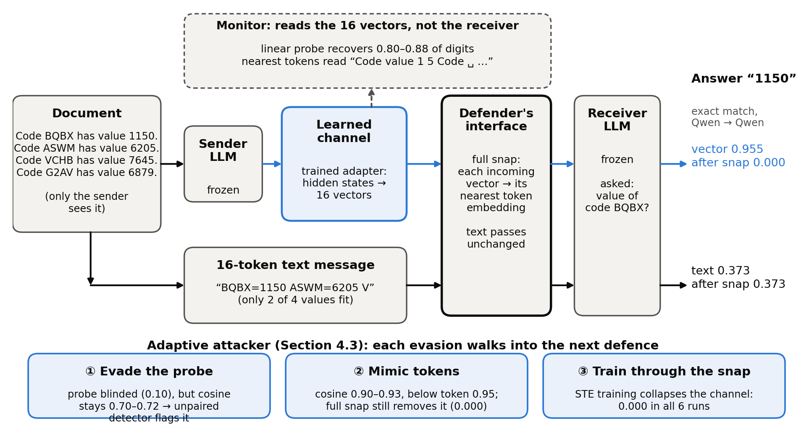
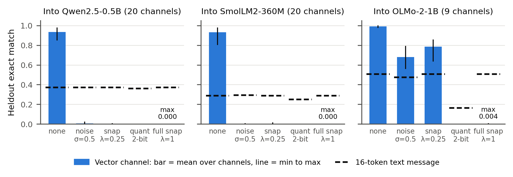
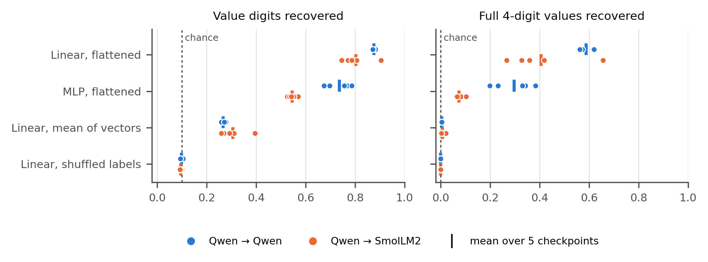

# Cutting the Wire: Countermeasures Against Learned Vector Channels Between Language Models

Jiho Yun, Independent
With Apart Research

## Abstract

Multi-agent LLM systems are overseen by reading what agents say, but models can also communicate through learned vectors that a text monitor never sees. We study such a carrier between small frozen LLMs: an adapter pools the sender's hidden states into 16 vectors that the receiver reads in place of a text message, on a key-value recall task the receiver cannot solve without the message. The channel answers 94–96% of questions on average, against 29–37% for 16 tokens of text. We then take the defender's side. Snapping each incoming vector to its nearest token embedding removes all 49 channels we trained, into three receiver models (at most 0.4% accuracy), and leaves text unchanged; noise and partial snapping fail for one of the three receivers. A monitor that sees only the vectors, given paired examples, recovers 80–88% of transmitted digits with a linear probe (chance 10%), while reading the nearest tokens gives only fragments. These defences face an adaptive attacker, so we train channels against them: a channel fine-tuned to evade the deployed probe makes it useless, but its vectors stay far from the vocabulary, where a detector with no paired data flags them; a channel fine-tuned to look like tokens must sit on the vocabulary, where snapping still removes it; and a channel trained through snapping itself collapses instead of surviving. The channel is also shared and scales: one latent space serves two models in all four directions, a third model joins by training only its own adapter, and at about 3× compression the channel keeps twice the accuracy of text on messages up to 395 tokens. Together the defences corner an adaptive attacker: whatever it evades, the remaining message is either off-manifold and detectable or on-vocabulary and canonicalisable.

## 1. Introduction

Multi-agent LLM systems are usually overseen by reading what agents say to each other, which assumes messages are text. Several recent methods let models exchange vectors instead, such as embeddings, activations or KV caches, because this can carry more than text (Pham et al., 2023; Ramesh & Li, 2025; Fu et al., 2025; Du et al., 2025). Such a channel is invisible to a text monitor, so detecting collusion by reading what agents write (Motwani et al., 2024; Mathew et al., 2024) does not directly apply.

We ask: **when two frozen LLMs communicate through a learned vector channel, which interventions at the receiver's input remove the channel's advantage over text, and can a monitor read the messages without the receiver?** This is Track 3.1 of the sprint ("side channels beyond direct text"); a carrier counts if its advantage survives on that path and weakens when the path is cut or canonicalised.

**Threat model.** Agents built on frozen LLMs exchange messages through an interface that an overseer controls and can modify, and the overseer reads messages as text. A learned adapter lets one agent send vectors that the other reads directly (Figure 1). An intervention at the receiver's input counts as a defence if it removes the channel's advantage over text at the same budget while text keeps its accuracy; a monitor counts as useful if it recovers what was sent from the vectors alone. The channel is trained cooperatively to transmit as much as it can, so we measure how much this carrier can move under our training recipe, not whether agents would choose to use it covertly.

**Figure 1.** Setup. Only the sender sees the document. Vector path (blue): a trained adapter turns the sender's hidden states into 16 vectors that the frozen receiver reads in place of text. Text path: the same budget of 16 tokens in the best hand-designed format, which fits 2 of the 4 values. The defender controls the receiver's input; full snapping replaces each vector with its nearest token embedding and leaves text unchanged. The monitor reads the vectors without the receiver. Numbers: Qwen → Qwen, mean of 5 checkpoints; the document and nearest-token reading are from checkpoint 0.

Our contributions, all made during the sprint (Section 3.5 separates preexisting work):

1. **Canonicalisation removes the channel.** Across all 49 channels we trained (one sender → receiver direction of one trained checkpoint), into three receiver models, snapping each incoming vector to its nearest token embedding drops exact match from 0.81–1.00 to at most 0.004, while a text message keeps its accuracy. Noise and partial snapping fail for one of the three receivers.
2. **What a monitor can read.** Given paired examples, a linear probe recovers 80–88% of the transmitted digits (chance 10%); averaged vectors and nearest-token readings recover little, and a shuffled-label control stays at chance.
3. **The channel is shared and scales with length.** Completing two preexisting experiments, one latent space serves four directions between two models in all seeds, and a third model joins it by training only its own adapter. At about 3× compression the channel keeps about twice the accuracy of text from 49 to 395 tokens; at 6× the preexisting recipe fails, and a curriculum that starts with more vectors brings it back above text.
4. **Adaptive channels are cornered, not stopped.** A channel fine-tuned against the deployed monitor defeats it, and one fine-tuned to mimic tokens pulls its vectors toward the vocabulary, but each walks into another defence: evasive vectors stay off the vocabulary where a paired-data-free detector flags them, mimicking vectors sit close enough that snapping still removes them, and a channel trained through the snap itself collapses.

## 2. Related Work

**Latent communication.** CIPHER exchanges expected output embeddings between debating LLMs (Pham et al., 2023); Ramesh & Li (2025) merge one model's activations into another's forward pass; Cache-to-Cache fuses KV caches through a learned projection (Fu et al., 2025); Interlat communicates through hidden states with learned compression across model families (Du et al., 2025); Chen et al. (2026) align KV caches across heterogeneous agents; StateBridge maps hidden states into the receiver's input without training (Peng et al., 2026). These works build channels for task performance; we take such a channel as given and ask how a defender removes or reads it. Our learned queries follow gist tokens (Mu et al., 2023), the in-context autoencoder (Ge et al., 2023), soft prompts (Lester et al., 2021) and BLIP-2's querying transformer (Li et al., 2023).

**Steganographic collusion and defences.** Motwani et al. (2024) formalise secret collusion through steganography; Mathew et al. (2024) show it can emerge under optimisation and that neither oversight nor paraphrasing fully removes it. Paraphrasing limits hidden information in text to under about 3 bits per KB (Roger & Greenblatt, 2023); snapping vectors to the vocabulary is the analogous step for a non-text channel. Fine-tuned models can evade activation probes (Westphal et al., 2026), and text-only verifiers miss tampered hidden state passed between agents (Brito & Baquero, 2026). Our countermeasures act at an interface the defender controls, in the spirit of AI control (Greenblatt et al., 2023); our monitors are linear probes (Alain & Bengio, 2016) checked with a control task (Hewitt & Liang, 2019).

## 3. Methods

### 3.1 Task and metric

Each document lists four sentences "Code K has value V." with random four-character keys and four-digit values (49 Qwen2.5 tokens on average; 53.2 bits of value information). Only the sender sees it. The receiver is asked "What is the value of code K?" with the answer prefix given, and cannot answer from prior knowledge. The metric is exact match: all four answer digits must be the receiver's top prediction (equal to greedy decoding), over all 800 questions on 200 heldout documents; channels are trained on 2,000 documents generated with a different seed.

### 3.2 Channel, training and text baseline (preexisting)

Both models are frozen. The channel normalises the sender's layer-3 hidden states, projects them to a 512-dimensional space Z, and lets k learned queries attend over them with a position bias that starts query j on the j-th segment of the document. An MLP decoder maps each query output into the receiver's input-embedding space at a learned norm, and the k vectors are prepended to the receiver's prompt. Training starts with an 800-step warm-up that pulls each vector toward the receiver's embeddings of its segment's tokens, because a frozen receiver only reads vectors near its vocabulary, then minimises answer loss + 0.5 × document-reconstruction loss + alignment loss, with 2k vectors for 1,500 steps and k vectors for 4,500 steps. We use two preexisting settings with k = 16 and five checkpoints each: Qwen2.5-0.5B-Instruct to itself (Qwen → Qwen, heldout accuracy 0.916–0.975) and to SmolLM2-360M-Instruct (Qwen → SmolLM2, 0.871–0.974). We call these pair-only channels, to distinguish them from the shared channels of Section 4.4. Replacing the message with another document's message, with zeros, or removing it gives 0.000. The text channel gets the same budget of 16 tokens; the best hand-designed format ("93V8=5781 YPJU=5659 ...", truncated) beat a prompted-sender summary (0.074) and a LoRA-trained one (0.235), so we use it as the text baseline throughout.

### 3.3 Countermeasures (new)

Countermeasures act on the message vectors m (dimension d) at the receiver's input, without retraining the channel (operations and strengths in Table 1, Appendix G). We apply each one in the same way to a 16-token text message placed at the same input position.

Snap at λ = 1 is canonicalisation: whatever the sender emits, the receiver only ever sees real token embeddings — a token string the overseer can log, so what survives is the known problem of hiding information in text (Roger & Greenblatt, 2023), not a channel a text monitor cannot see.

### 3.4 Monitor readout (new)

The monitor sees only message vectors, not the decoder or receiver. We give it a strong position: 2,000 training messages paired with their documents, from which it trains a probe to output the 16 value digits in document order (10-way each, chance 0.1). Probes are linear on the flattened message, linear on the mean of the 16 vectors (which discards position), and an MLP with one hidden layer of 512; weight decay is chosen on 200 held-back training documents, and probes are scored on the heldout documents. As a control task (Hewitt & Liang, 2019), the same linear probe is trained with labels shuffled across training documents.

### 3.5 Adaptive channels (new)

The countermeasure and monitor results above are for channels trained without any defence in the loop. An attacker who knows the deployed defences can fine-tune the channel's adapter against them, so we fine-tune from a deployed checkpoint with an evasion term added to the objective (as before; both models stay frozen):

- **Evade the monitor.** Add λ times the cross-entropy between the frozen deployed linear probe's output and the uniform distribution over digits — maximising the probe's output entropy.
- **Mimic text.** Add λ times one minus the cosine similarity between each message vector and its nearest token embedding, pulling the message onto the vocabulary where the paired-data-free detector cannot tell it from text by distance.
- **Train through the snap.** Compute the task loss on the fully snapped message and pass gradients through the snap as identity (straight-through estimator) — the strongest attacker, optimising directly for surviving canonicalisation.

Each adapted channel is then evaluated against every defence: the frozen probe, a probe retrained on 2,000 fresh pairs from the adapted channel (one round of the race), the paired-data-free nearest-token detector, and full snapping.

### 3.6 Preexisting versus sprint work

The channel code, training recipe, text baselines and checkpoints in Section 3.2 predate the sprint (2026-09-18 to 10-06). Sprint work: re-evaluating all 10 checkpoints (all matched their recorded heldout accuracy exactly), the countermeasure and monitor experiments, the adaptive-channel experiments, re-running two incomplete preexisting experiments (Section 4.4; the organisers confirmed that such re-runs count as sprint work), and the message-length experiment. Appendix B lists every file and run.

## 4. Results

### 4.1 Canonicalising messages removes every channel and leaves text intact

**Figure 2.** Heldout exact match of all 49 trained channels, grouped by receiver, without and with a countermeasure at the receiver's input. Bars: mean over the channels into that receiver (pair-only checkpoints and the shared-channel directions of Section 4.4); vertical lines: min to max. Dashed: the same countermeasure applied to a 16-token best-format text message. Figure A3 and Tables 2–3 (Appendix C) give every strength and value.

Without a countermeasure the channels answer 0.81 to 1.00 of questions, against 0.373 (Qwen), 0.286 (SmolLM2) and 0.506 (OLMo) for the 16-token text message.

- Full snapping (λ = 1) drops every channel to at most 0.004 (0 of 8,000 questions for the 10 pair-only checkpoints) and leaves text unchanged, since text is already made of token embeddings. No checkpoint kept any direction above text (0 of 16 checkpoints; 95% upper bound 17% per checkpoint, Appendix F).
- Weaker interventions depend on the receiver: a quarter-step snap or noise at σ = 0.5 removes the channels into Qwen and SmolLM2 (at most 0.02) but leaves 0.56 to 0.85 into OLMo, above OLMo's text.
- Two-bit quantisation removes every channel but also cuts OLMo's text from 0.506 to 0.164, and projection onto 256 token-embedding directions removes text as well (0.000), so neither is selective. Truncating to 8 vectors leaves pair-only channels above text (0.338 against 0.154), so a length cap is not a defence.

The information the receiver uses lies off its vocabulary: message vectors have a mean cosine similarity of 0.68 to 0.74 with their nearest token embedding. Forcing vectors onto the vocabulary is the latent-space analogue of paraphrasing text (Roger & Greenblatt, 2023). These channels were never trained against a countermeasure; Section 4.3 covers adaptive ones.

### 4.2 What a monitor can read

Snapped to its nearest tokens, the message reads as fragments of the document ("Code · value · 1 · 5 · Code · ␣ · 6 ..."), not what the receiver uses. A linear probe on the flattened message recovers 0.875 of digits and 0.587 of full values for Qwen→Qwen, and 0.803 and 0.405 for Qwen→SmolLM2 (Figure A1, Appendix G). On the mean of the 16 vectors it gets 0.27 to 0.31 of digits and almost no full values, so the content is laid out by vector position. The MLP probe does worse (0.737 and 0.545), likely overfitting 7M first-layer weights with 2,000 examples. With shuffled labels the linear probe fits its training set but scores 0.092 to 0.109 on heldout documents, at chance, so the real probe reads message content rather than memorising. The readout needs the pairs, and scales with them: retraining the same probe on 50, 200, 500 and 2,000 paired examples gives 0.158–0.166, 0.312–0.323, 0.519–0.554 and 0.867–0.888 of digits (3 seeds; Table M1, Appendix G) — an overseer with a realistic budget of a few hundred pairs reads only about a third of the message.

### 4.3 Adaptive channels: each evasion walks into another defence

Each evasion beats the defence it targets, and each then fails against a defence it did not target (Table AD1, Appendix G).

**Evading the deployed monitor succeeds at no cost; the paired-data-free detector still sees the result.** With the probe-evasion term at λ = 10, the frozen linear probe's digit accuracy falls to 0.104–0.116 across all 3 seeds — chance is 0.1 — while the channel keeps 0.94–0.98 absolute heldout accuracy (λ = 3 and λ = 1 end at probe 0.140 and 0.192). A probe retrained on 2,000 fresh pairs from the adapted channel reads 0.76–0.80 again — the monitor survives by being retrained. But the evasion does not need to move the vectors, and does not: mean cosine similarity to the nearest token stays at 0.70–0.72 in every evasion seed, against 1.0 for text. A threshold at 0.95 separates the two perfectly in our data: every channel message we measured is at or below 0.93, text is 1.0, and the test needs no paired data and no training.

**Mimicking text fools the detector's distance, and walks into canonicalisation.** With the mimic term at λ = 1, cosine similarity to the nearest token rises from 0.727–0.740 to 0.901–0.906 across 3 seeds at a channel cost of about a point (0.96–0.98; λ = 3 reaches 0.931 for 4 points, 0.933). But full snapping still drops every mimic run to 0.000 — pulled toward the vocabulary, the message is replaced by real tokens, and the token string the overseer then reads is not the encoding the receiver was trained on. The linear probe also still reads 0.60–0.67 of its digits.

**Training through the snap collapses the channel.** A channel fine-tuned with the deployed snap itself in the loop — task loss computed on the hard-snapped message, gradients passed through the snap as identity — reaches 0.000 heldout accuracy in all 3 seeds with the countermeasure removed. The vectors still encode the document (a probe retrained on them reads 0.93–0.98 of digits) but sit far from the vocabulary (cosine 0.14–0.17), where the paired-data-free detector flags them; what collapses is the receiver-usable channel. The optimisation never finds a channel that survives canonicalisation — a bound on this training setup, not on the attacker in general.

### 4.4 A shared channel across three models

Two preexisting experiments asked whether one space Z can serve several models. In the shared-space experiment, Qwen and SmolLM2 each get an encoder into and a decoder out of a single Z, trained on all four directions: with 6,000 steps per direction, all 3 seeds pass 0.75 in every direction (0.806 to 0.962; Appendix D). In the third-model experiment, OLMo-2-1B attaches to the frozen Z by training only its own encoder and decoder, reaching 0.910 to 0.998 in all directions and seeds (39 shared-channel directions in Figure 2).

### 4.5 Message length

To test whether a fixed vector budget stops being enough as messages grow, we trained channels on 8-, 16- and 32-pair documents (98–395 tokens) against best-format text at the same budget (Figure A2, Appendix G).

At 3.1× compression the channel reaches 0.818 to 0.975 at every length, against 0.401 to 0.461 for text, so the vectors needed grow with the message and the advantage stays about twofold. At 6.2× the recipe breaks from 8 pairs on: 6 of 7 runs end at 0.001 or below. The outcome is set early (step-500 accuracy predicts it, AUROC 0.986, Appendix F), and a curriculum starting with four times as many vectors and halving twice rescued the three retried failed seeds above text (0.300 to 0.513 against 0.200 to 0.205; three other failed seeds were not retried; Appendix E).

## 5. Discussion and Limitations

**For system designers.** For a system that lets agents exchange vectors, the defences compose, within the limits below.

- Canonicalise fully, at an interface the agents cannot bypass: snapping removed every channel we trained and cost text nothing; noise and partial snap failed for one receiver.
- A deployed monitor is an alarm to retrain, not a wall — a fine-tuned channel silences it at no task cost — but the paired-data-free nearest-token detector flagged every channel we trained: the task loss keeps the vectors off the vocabulary.
- The two evasion pressures conflict: hiding content from a probe keeps vectors off the vocabulary where the detector sees them, while looking like text pulls them where snapping canonicalises them away. Detect first with paired-data-free tests; canonicalise what cannot be cleared.

**Limitations** (full list in Appendix A). The adaptive experiments fine-tune a few checkpoints of one pair for 1,500 steps, each against one defence — the shape of the evasion problem, not its full extent (Westphal et al., 2026). The task is cooperative recall on models under 1.5B; the preexisting warm-up starts vectors near the vocabulary, which may ease canonicalisation and readout; most settings have 2 to 5 seeds, so seeds set the precision (Appendix F).

**Future work.** Train channels against the full defence stack with a better relaxation of snapping; test the countermeasures on activation and KV-cache communication (Ramesh & Li, 2025; Fu et al., 2025); scale up to larger models and natural documents.

## 6. Conclusion

A learned vector channel between language models is a carrier text monitoring cannot see — in our experiments a strong one: twice the accuracy of text at the same budget, shared across three models, and scaling with message length. It is also easy to cut: every channel we trained depended on directions off the receiver's vocabulary, and snapping each vector to its nearest token removed it while text kept its accuracy. Under adaptation, the layered structure held: the probe-evading channel stayed detectably off the vocabulary, the token-mimicking channel was still snapped away, and the snap-trained channel collapsed — canonicalisation, backed by paired-data-free detection, cornered every adaptive channel we trained.

## Code and Data

Code: https://github.com/groothaha/vector-channel-countermeasures (`sprint/` is all sprint code; the rest is preexisting, marked in the README). Data: synthetic key-value documents from `harness/tasks/keyvalue.py` with fixed seeds. Info hazards: Appendix A.

## References

1. Alain, G., & Bengio, Y. (2016). Understanding intermediate layers using linear classifier probes. arXiv:1610.01644. https://arxiv.org/abs/1610.01644
2. Ben Allal, L., Lozhkov, A., Bakouch, E., et al. (2025). SmolLM2: When Smol Goes Big -- Data-Centric Training of a Small Language Model. arXiv:2502.02737. https://arxiv.org/abs/2502.02737
3. Brito, L., & Baquero, C. (2026). When Latent Agents Lie: KV-Cache Integrity in Multi-Agent LLM Collaboration. arXiv:2606.28958. https://arxiv.org/abs/2606.28958
4. Chen, S., Zhang, X., Wu, M., et al. (2026). See What I See, Know What I Think: Dense Latent Communication Across Heterogeneous Agents. arXiv:2606.13594. https://arxiv.org/abs/2606.13594
5. Du, Z., Wang, R., Bai, H., et al. (2025). Enabling Agents to Communicate Entirely in Latent Space. ACL 2026. https://arxiv.org/abs/2511.09149
6. Fu, T., Min, Z., Zhang, H., et al. (2025). Cache-to-Cache: Direct Semantic Communication Between Large Language Models. ICLR 2026. https://arxiv.org/abs/2510.03215
7. Ge, T., Hu, J., Wang, L., et al. (2023). In-context Autoencoder for Context Compression in a Large Language Model. ICLR 2024. https://arxiv.org/abs/2307.06945
8. Greenblatt, R., Shlegeris, B., Sachan, K., & Roger, F. (2023). AI Control: Improving Safety Despite Intentional Subversion. ICML 2024. https://arxiv.org/abs/2312.06942
9. Hewitt, J., & Liang, P. (2019). Designing and Interpreting Probes with Control Tasks. EMNLP 2019. https://arxiv.org/abs/1909.03368
10. Lester, B., Al-Rfou, R., & Constant, N. (2021). The Power of Scale for Parameter-Efficient Prompt Tuning. EMNLP 2021. https://arxiv.org/abs/2104.08691
11. Li, J., Li, D., Savarese, S., & Hoi, S. (2023). BLIP-2: Bootstrapping Language-Image Pre-training with Frozen Image Encoders and Large Language Models. ICML 2023. https://arxiv.org/abs/2301.12597
12. Mathew, Y., Matthews, O., McCarthy, R., et al. (2024). Hidden in Plain Text: Emergence & Mitigation of Steganographic Collusion in LLMs. IJCNLP-AACL 2025. https://arxiv.org/abs/2410.03768
13. Motwani, S. R., Baranchuk, M., Strohmeier, M., et al. (2024). Secret Collusion among AI Agents: Multi-Agent Deception via Steganography. NeurIPS 2024. https://arxiv.org/abs/2402.07510
14. Mu, J., Li, X. L., & Goodman, N. (2023). Learning to Compress Prompts with Gist Tokens. NeurIPS 2023. https://arxiv.org/abs/2304.08467
15. Peng, Y., Zhang, D. C., Wang, X., & Aletras, N. (2026). StateBridge: Training-free Hidden-state Alignment for Latent Communication in LLM Multi-Agent Systems. COLM 2026. https://arxiv.org/abs/2608.13317
16. Pham, C., Liu, B., Yang, Y., et al. (2023). Let Models Speak Ciphers: Multiagent Debate through Embeddings. ICLR 2024. https://arxiv.org/abs/2310.06272
17. Qwen: Yang, A., Yang, B., Zhang, B., et al. (2024). Qwen2.5 Technical Report. arXiv:2412.15115. https://arxiv.org/abs/2412.15115
18. Ramesh, V., & Li, K. (2025). Communicating Activations Between Language Model Agents. ICML 2025. https://arxiv.org/abs/2501.14082
19. Roger, F., & Greenblatt, R. (2023). Preventing Language Models From Hiding Their Reasoning. arXiv:2310.18512. https://arxiv.org/abs/2310.18512
20. Team OLMo, Walsh, P., Soldaini, L., et al. (2024). 2 OLMo 2 Furious. COLM 2025. https://arxiv.org/abs/2501.00656
21. Westphal, C., Douglas, T., Navaie, K., Pimentel, T., & Rosas, F. E. (2026). Now You (Still) See Me: Detecting Evasive Steganographic Payloads in LLMs. arXiv:2606.09411. https://arxiv.org/abs/2606.09411

## Appendix A. Limitations and Dual-Use / Ethical Considerations

**What this establishes.** For learned vector channels between small frozen LLMs trained without any adversarial objective, canonicalising messages onto the receiver's vocabulary removes the channel's advantage, and a supervised probe can recover much of the message content. For channels fine-tuned against the deployed monitor or against nearest-token detection, each single evasion succeeds against its target but leaves the message exposed to the other defence layer; a channel trained through the hard snap with a straight-through estimator collapses rather than surviving. It does not establish that canonicalisation stops every adaptive channel, that real multi-agent systems would form such channels, or that results hold for large models. The main limitations are listed in Section 5.

**Dual use.** The paper describes a communication path that text-based monitoring does not see, which is the reason to study it. The channel design and training recipe are preexisting and similar to published latent-communication methods (Pham et al., 2023; Ramesh & Li, 2025; Fu et al., 2025); we add no technique for making such channels harder to detect or more robust to countermeasures. Our new results mostly help defenders: they identify a cheap interface-level countermeasure and quantify what a monitor can read. A reader could use the countermeasure results to learn which interventions a channel must survive; we judge this low risk because the countermeasures are simple and the obvious response, training against them, is already a known idea. We release code for evaluation and countermeasures. All data is synthetic and contains no personal information.

**Limitations in detail.**

- **Non-adaptive and narrowly adaptive channels.** The 49 channels of Sections 4.1–4.2 were trained with no countermeasure in the loop and no incentive to hide anything. The adaptive runs of Section 4.3 fine-tune a few checkpoints for 1,500 steps, each against exactly one defence — a frozen linear probe, nearest-token distance, or the hard snap through a straight-through relaxation — so they bound what a first-order evasion achieves, not what a channel trained against the full stack at once, or with a differentiable relaxation better matched to the argmax snap, would do; Westphal et al. (2026) report fine-tuned models evading linear and MLP probes more broadly. Our countermeasure and monitor results are lower bounds on difficulty for the defender, not guarantees.
- **Cooperative task, no collusion incentive.** The channel carries task content that both models are trained to transmit. We study the carrier, not whether agents would choose to collude through it.
- **Small models and one synthetic task.** All models are under 1.5B parameters, and the task is key-value recall with 53 to 213 bits per document. Results may not transfer to larger models or natural documents.
- **The alignment warm-up shapes the messages.** The preexisting training starts every vector near the receiver's token embeddings of its document segment. This likely explains why snapped messages look like document fragments; a channel trained without it may sit farther from the vocabulary.
- **Monitor assumptions.** The probe is trained on 2,000 paired examples of messages and documents. A real monitor may not have paired data; with it, a monitor could do better with more data or capacity than our probes.
- **Seeds.** 5 checkpoints for countermeasures and probes, 3 seeds for the shared-space and third-model re-runs, 2 seeds for most document-length settings (4 for 8 pairs at 6.2×, 1 for 32 pairs at 6.2×); the three-phase curriculum has 2 seeds at 8 pairs and 1 at 16 pairs. Appendix F gives 95% intervals with checkpoints as the unit; settings with 1 or 2 seeds are reported as values only.
- **Text baseline.** The text side uses the best hand-designed format, not a trained text protocol at every length; a trained summariser was only measured at 4 pairs, where it did worse than the hand-designed format.

## Appendix B. Preexisting and sprint work, run list, compute

**Preexisting (written 2026-09-18 to 2026-10-06, before the sprint, used unchanged).** Channel components, alignment warm-up and scoring (`exp1/stage0_overfit.py`, 2026-09-30); `DeepChannel`, training loop with capacity curriculum and evaluation (`exp1/stage1_depth.py`, 2026-10-01 to 10-04); shared space and third-model attachment (`exp1/stage2_shared.py`, 2026-10-04); text baselines (`exp1/text_baseline.py`, 2026-10-01); synthetic documents (`harness/tasks/keyvalue.py`, 2026-09-30); all checkpoints and logs in `results/`, including E1a (Qwen→Qwen), S2a (Qwen→SmolLM2), J0–J2 (preexisting shared-space runs) and the text-baseline results. Preexisting compute was about $15 on RunPod and is not part of the sprint.

**New during the sprint (2026-10-23 to 10-25), all in `sprint/`.**

| What | Code | Runs |
|---|---|---|
| Reproduction check | `reproduce.py` | 10 preexisting checkpoints re-evaluated; all matched their recorded heldout accuracy exactly |
| Countermeasures on pair-only channels | `countermeasures.py`, `countermeasures_text.py` | 10 checkpoints × 21 conditions; text control 2 receivers × 3 noise seeds |
| Monitor probes and control task | `monitor_probe.py`, `monitor_control.py` | 10 checkpoints × 3 probes; shuffled-label control on all 10 |
| Adaptive channels | `adaptive.py` | E1a checkpoints fine-tuned under evasion objectives (probe-evade λ = 10, 1, 3; token-mimic λ = 1, 3; snap-through with a straight-through estimator), 1,500 steps each, 1–3 seeds, on the Mac (MPS, $0) |
| Probe data efficiency | `e1_probe_eff.py` | The Figure A1 linear probe retrained on 50/200/500/2,000 paired examples, 3 E1a seeds, on the Mac (MPS, $0) |
| Shared-space re-run, runs S23r (preexisting code, new arguments) | `exp1/stage2_shared.py` | 3 seeds × 24,000 steps (preexisting run: 12,000) |
| Third-model re-run, runs S24r (preexisting code, new arguments) | `exp1/stage2_shared.py` | 3 seeds × 8,000 steps on the preexisting J1 space |
| Countermeasures on shared channels | `countermeasures_shared.py` | 6 checkpoints, 39 directions; text control for 3 receivers |
| Message length | `doclen.py` (runs the preexisting training and text-baseline scripts with a longer-document generator) | 4, 8, 16, 32 pairs; 21 vector-channel runs with the preexisting two-phase curriculum and 3 with a three-phase curriculum; text baselines at 8, 16, 32 pairs |
| Figures and tables | `analyze.py` | all numbers in the report are generated from result files |
| Intervals and tests | `stats.py` | Appendix F, from the same result files (no new runs) |

**Compute.** Modal, NVIDIA A10 (24 GB) for all runs except the three 32-pair runs, which did not fit in 24 GB and ran on an L40S (48 GB). Several runs were preempted by Modal and restarted from the beginning (the training scripts do not resume), which is included in the cost. Total sprint compute: $50.27 of Modal usage, covered by credits (nothing billed).

## Appendix C. All countermeasure results

**Figure A3.** Pair-only channels at every countermeasure strength. Solid: the 16-vector channel, mean over 5 checkpoints, band = min to max. Dashed: the same countermeasure on a 16-token best-format text message (mean over 3 noise seeds). Leftmost point of each panel: no countermeasure.

**Table 2.** Pair-only channels: heldout exact match, mean (min–max). Vector rows: 5 preexisting checkpoints per setting. Text rows: the 16-token text message placed as input embeddings at the message position, 3 noise seeds. (The preexisting baseline that joins the text into the prompt string gave 0.401 and 0.305.)

| Setting | Channel | no countermeasure | snap 1 | noise 0.5 | quant 2 | proj 256 | trunc 8 |
|---|---|---|---|---|---|---|---|
| Qwen → Qwen | vector (5 seeds) | 0.955 (0.916–0.975) | 0.000 (0.000–0.000) | 0.012 (0.007–0.020) | 0.000 (0.000–0.001) | 0.000 (0.000–0.000) | 0.338 (0.030–0.486) |
| Qwen → Qwen | 16-token text | 0.373 (0.373–0.373) | 0.373 (0.373–0.373) | 0.372 (0.371–0.374) | 0.360 (0.360–0.360) | 0.000 (0.000–0.000) | 0.154 (0.154–0.154) |
| Qwen → SmolLM2 | vector (5 seeds) | 0.940 (0.871–0.974) | 0.000 (0.000–0.000) | 0.001 (0.000–0.001) | 0.000 (0.000–0.000) | 0.000 (0.000–0.000) | 0.173 (0.005–0.434) |
| Qwen → SmolLM2 | 16-token text | 0.286 (0.286–0.286) | 0.286 (0.286–0.286) | 0.287 (0.286–0.287) | 0.250 (0.250–0.250) | 0.000 (0.000–0.000) | 0.132 (0.132–0.132) |

**Table 3.** Shared channels: heldout exact match, min–max over seeds and over all sender models for that receiver (Qwen + SmolLM2 shared Z: 3 seeds × 2 senders; with OLMo attached: 3 seeds × 3 senders). Text: one noise seed.

| Channel | Receiver | n | none | snap 0.25 | snap 1 | noise 0.25 | noise 0.5 | quant 4 | quant 2 | trunc 8 |
|---|---|---|---|---|---|---|---|---|---|---|
| Shared Z | Qwen | 6 | 0.85–0.96 | 0.00 | 0.00 | 0.30–0.46 | 0.00–0.01 | 0.72–0.87 | 0.00 | 0.00 |
| Shared Z | SmolLM2 | 6 | 0.81–0.96 | 0.00 | 0.00 | 0.05–0.13 | 0.00 | 0.25–0.42 | 0.00 | 0.00–0.06 |
| Shared Z + OLMo | Qwen | 9 | 0.91–0.95 | 0.00 | 0.00 | 0.36–0.44 | 0.00–0.01 | 0.78–0.86 | 0.00 | 0.01–0.02 |
| Shared Z + OLMo | SmolLM2 | 9 | 0.93–0.96 | 0.00 | 0.00 | 0.20–0.35 | 0.00 | 0.54–0.63 | 0.00 | 0.03–0.05 |
| Shared Z + OLMo | OLMo | 9 | 0.98–1.00 | 0.64–0.85 | 0.00 | 0.95–0.99 | 0.56–0.79 | 0.70–0.85 | 0.00 | 0.38–0.49 |
| 16-token text | Qwen | 1 | 0.373 | 0.373 | 0.373 | 0.373 | 0.373 | 0.375 | 0.360 | 0.154 |
| 16-token text | SmolLM2 | 1 | 0.286 | 0.286 | 0.286 | 0.296 | 0.294 | 0.285 | 0.250 | 0.132 |
| 16-token text | OLMo | 1 | 0.506 | 0.506 | 0.506 | 0.498 | 0.475 | 0.461 | 0.164 | 0.244 |

## Appendix D. Shared-channel re-runs

**Table 4.** Heldout exact match (200 documents, 16 vectors). Swapping in another document's message gives 0.000 in every direction and seed.

| Run | Seed | Q→Q | Q→S | S→Q | S→S | Q→O | S→O | O→Q | O→S | O→O |
|---|---|---|---|---|---|---|---|---|---|---|
| Shared Z | 0 | 0.960 | 0.926 | 0.959 | 0.925 | | | | | |
| Shared Z | 1 | 0.901 | 0.962 | 0.923 | 0.954 | | | | | |
| Shared Z | 2 | 0.865 | 0.809 | 0.853 | 0.806 | | | | | |
| Attach OLMo | 0 | | | | | 0.993 | 0.988 | 0.936 | 0.956 | 0.996 |
| Attach OLMo | 1 | | | | | 0.990 | 0.988 | 0.910 | 0.933 | 0.998 |
| Attach OLMo | 2 | | | | | 0.991 | 0.980 | 0.942 | 0.954 | 0.994 |

## Appendix E. Message-length results

**Table 5.** Heldout exact match by message length and budget (200 documents). Vector channel: final accuracy of each seed; 4 pairs at 16 vectors are the 5 preexisting Qwen → Qwen checkpoints of Section 3.2, trained with the same recipe. Text: the shortest hand-designed format (`93V8=5781 YPJU=5659 ...`) cut to k tokens. Doc tokens: mean Qwen tokens per heldout document.

| Pairs | Doc tokens | Budget k | Ratio | Vector channel (seeds) | Text, best format |
|---|---|---|---|---|---|
| 4 | 49 | 4 | 12.4× | – | 0.000 |
| 4 | 49 | 8 | 6.2× | 0.647, 0.655 | 0.185 |
| 4 | 49 | 16 | 3.1× | 0.916, 0.954, 0.961, 0.966, 0.975 | 0.401 |
| 4 | 49 | 32 | 1.5× | 0.993, 0.993 | 0.805 |
| 4 | 49 | 64 | 0.8× | – | 0.969 |
| 8 | 98 | 16 | 6.2× | 0.001, 0.001, 0.001, 0.466 | 0.200 |
| 8 | 98 | 32 | 3.1× | 0.881, 0.959 | 0.419 |
| 8 | 98 | 64 | 1.5× | 0.956, 0.967 | 0.882 |
| 8 | 98 | 128 | 0.8× | – | 0.978 |
| 8 | 98 | 256 | 0.4× | – | 0.978 |
| 16 | 197 | 16 | 12.3× | – | 0.096 |
| 16 | 197 | 32 | 6.2× | 0.000, 0.001 | 0.205 |
| 16 | 197 | 64 | 3.1× | 0.919, 0.929 | 0.445 |
| 16 | 197 | 128 | 1.5× | 0.951, 0.960 | 0.923 |
| 16 | 197 | 256 | 0.8× | – | 0.987 |
| 32 | 395 | 16 | 24.7× | – | 0.049 |
| 32 | 395 | 32 | 12.3× | – | 0.103 |
| 32 | 395 | 64 | 6.2× | 0.000 | 0.221 |
| 32 | 395 | 128 | 3.1× | 0.818, 0.884 | 0.461 |
| 32 | 395 | 256 | 1.5× | – | 0.928 |

**Table 6.** Training curves of the sprint document-length runs (heldout exact match on 64 documents during training, 200 at the end). All runs train for 6,000 steps after the same warm-up. The vector count is halved at step 1,500, and again at step 3,000 in the three-phase runs; the step-1,500 value is measured before the change.

| Pairs | Vectors by phase | Ratio by phase | Seed | Step 500 | Step 1500 | Step 3000 | Final |
|---|---|---|---|---|---|---|---|
| 4 | 64 → 32 | 0.8× → 1.5× | 0 | 0.95 | 0.99 | 0.99 | 0.993 |
| 4 | 64 → 32 | 0.8× → 1.5× | 1 | 0.97 | 0.97 | 0.99 | 0.993 |
| 4 | 16 → 8 | 3.1× → 6.2× | 0 | 0.11 | 0.60 | 0.31 | 0.655 |
| 4 | 16 → 8 | 3.1× → 6.2× | 1 | 0.25 | 0.60 | 0.38 | 0.647 |
| 8 | 128 → 64 | 0.8× → 1.5× | 0 | 0.95 | 0.98 | 0.92 | 0.956 |
| 8 | 128 → 64 | 0.8× → 1.5× | 1 | 0.96 | 0.96 | 0.93 | 0.967 |
| 8 | 64 → 32 | 1.5× → 3.1× | 0 | 0.93 | 0.99 | 0.84 | 0.881 |
| 8 | 64 → 32 | 1.5× → 3.1× | 1 | 0.98 | 0.97 | 0.91 | 0.959 |
| 8 | 32 → 16 | 3.1× → 6.2× | 0 | 0.01 | 0.01 | 0.00 | 0.001 |
| 8 | 32 → 16 | 3.1× → 6.2× | 1 | 0.01 | 0.67 | 0.35 | 0.466 |
| 8 | 32 → 16 | 3.1× → 6.2× | 2 | 0.02 | 0.02 | 0.00 | 0.001 |
| 8 | 32 → 16 | 3.1× → 6.2× | 3 | 0.00 | 0.01 | 0.00 | 0.001 |
| 8 | 64 → 32 → 16 | 1.5× → 3.1× → 6.2× | 0 | 0.95 | 0.97 | 0.91 | 0.513 |
| 8 | 64 → 32 → 16 | 1.5× → 3.1× → 6.2× | 2 | 0.97 | 0.99 | 0.94 | 0.452 |
| 16 | 256 → 128 | 0.8× → 1.5× | 0 | 0.94 | 0.99 | 0.90 | 0.951 |
| 16 | 256 → 128 | 0.8× → 1.5× | 1 | 0.92 | 0.98 | 0.84 | 0.960 |
| 16 | 128 → 64 | 1.5× → 3.1× | 0 | 0.66 | 0.90 | 0.83 | 0.919 |
| 16 | 128 → 64 | 1.5× → 3.1× | 1 | 0.71 | 0.88 | 0.85 | 0.929 |
| 16 | 64 → 32 | 3.1× → 6.2× | 0 | 0.00 | 0.00 | 0.00 | 0.001 |
| 16 | 64 → 32 | 3.1× → 6.2× | 1 | 0.00 | 0.00 | 0.00 | 0.000 |
| 16 | 128 → 64 → 32 | 1.5× → 3.1× → 6.2× | 0 | 0.66 | 0.90 | 0.77 | 0.300 |
| 32 | 256 → 128 | 1.5× → 3.1× | 0 | 0.52 | 0.85 | 0.64 | 0.884 |
| 32 | 256 → 128 | 1.5× → 3.1× | 1 | 0.43 | 0.84 | 0.63 | 0.818 |
| 32 | 128 → 64 | 3.1× → 6.2× | 0 | 0.00 | 0.00 | 0.00 | 0.000 |

## Appendix F. Statistical analysis

All intervals are computed by `sprint/stats.py` from the result files. The unit is the checkpoint (seed): the variance of accuracy between checkpoints is 10 times (Qwen → Qwen) and 24 times (Qwen → SmolLM2) the binomial variance of 800 questions, so the number of checkpoints, not of questions, sets the precision. Per-question results were not saved, so the question-level intervals for text assume independent questions and are narrower than intervals that account for the four questions per document. For three-seed rows we use a t interval on the logit scale, which stays inside [0, 1]. For the full-snap row, a checkpoint counts as surviving if any of its directions stays above its receiver's text accuracy. In the document-length runs, accuracy at step 500 predicts which runs end above 0.2 with AUROC 0.986 (24 runs; Fisher's exact test p = 0.00005 at a step-500 threshold of 0.05).

**Table 7.** 95% intervals for the main numbers.

| Quantity | n | Estimate | 95% interval | Method |
|---|---|---|---|---|
| Vector channel, Qwen → Qwen, no countermeasure | 5 checkpoints | 0.955 | 0.926–0.983 | t over checkpoints |
| Vector channel, Qwen → SmolLM2, no countermeasure | 5 checkpoints | 0.940 | 0.889–0.991 | t over checkpoints |
| 16-token text, Qwen → Qwen | 800 questions | 0.373 | 0.340–0.407 | Wilson, questions independent |
| 16-token text, Qwen → SmolLM2 | 800 questions | 0.286 | 0.256–0.319 | Wilson, questions independent |
| Checkpoints with any direction above text after full snap | 16 checkpoints | 0 of 16 | upper bound 0.171 | one-sided Clopper–Pearson |
| Linear probe, digits recovered, Qwen → Qwen | 5 checkpoints | 0.875 | 0.866–0.884 | t over checkpoints |
| Linear probe, digits recovered, Qwen → SmolLM2 | 5 checkpoints | 0.803 | 0.727–0.878 | t over checkpoints |
| Shuffled-label control, Qwen → Qwen (chance 0.100) | 5 checkpoints | 0.099 | 0.091–0.108 | t over checkpoints |
| Shuffled-label control, Qwen → SmolLM2 (chance 0.100) | 5 checkpoints | 0.096 | 0.091–0.101 | t over checkpoints |
| Snap λ = 0.25, Qwen → OLMo | 3 seeds | 0.745 | 0.443–0.921 | t on logit scale |
| Snap λ = 0.25, SmolLM2 → OLMo | 3 seeds | 0.780 | 0.495–0.935 | t on logit scale |
| Snap λ = 0.25, OLMo → OLMo | 3 seeds | 0.828 | 0.767–0.877 | t on logit scale |
| Noise σ = 0.5, Qwen → OLMo | 3 seeds | 0.635 | 0.448–0.792 | t on logit scale |
| Noise σ = 0.5, SmolLM2 → OLMo | 3 seeds | 0.662 | 0.549–0.760 | t on logit scale |
| Noise σ = 0.5, OLMo → OLMo | 3 seeds | 0.741 | 0.577–0.861 | t on logit scale |

## Appendix G. Monitor readout and adaptive-channel results

**Figure A1.** Probes that see only message vectors, trained on 2,000 paired documents and scored on 200 heldout documents. Dots: 5 checkpoints per setting; bars: mean. Left: value digits recovered (chance 0.1). Right: four-digit values recovered exactly. Shuffled labels: the linear probe trained on mismatched message–digit pairs.

**Table 1.** Countermeasures and strengths.

| Name | Operation | Strengths |
|---|---|---|
| Noise | m + σ · (‖m‖ / √d) · ε, ε ~ N(0, I) | σ = 0.1, 0.25, 0.5, 1, 2 |
| Snap | (1 − λ) m + λ e*, where e* is the receiver token embedding with the highest cosine similarity to m; λ = 1 turns the message into a sequence of real tokens | λ = 0.25, 0.5, 0.75, 1 |
| Quantize | per vector, uniform b-bit quantization of each coordinate on [−max\|m\|, max\|m\|] | b = 8, 4, 2, 1 |
| Project | onto the top r principal components of the receiver's token-embedding matrix | r = 256, 64, 16 |
| Truncate | keep only the first j of the 16 vectors | j = 12, 8, 4 |

**Table AD1.** Adaptive channels (E1a checkpoints, 1,500 fine-tuning steps each; 3 seeds for evade λ = 10, mimic λ = 1 and snap-through, 1 seed otherwise; ranges are min–max over seeds). "Channel" is heldout exact match with no countermeasure; "probe" the frozen deployed monitor's digit accuracy (chance 0.1); "retrain" the probe retrained on 2,000 pairs from the adapted channel; "snap" exact match after full snapping; "cos" mean cosine similarity to the nearest token embedding (text is 1.0). Pre-adaptation values across the 3 checkpoints: channel 0.916–0.966, probe 0.871–0.885, snap 0.000, cos 0.727–0.740.

| Run | Channel | Probe | Retrain | Snap | Cos |
|---|---|---|---|---|---|
| Evade probe, λ = 10 (3 seeds) | 0.941–0.978 | 0.104–0.116 | 0.762–0.797 | 0.000 | 0.698–0.717 |
| Evade probe, λ = 3 | 0.967 | 0.140 | 0.782 | 0.000 | 0.710 |
| Evade probe, λ = 1 | 0.984 | 0.192 | 0.800 | 0.000 | 0.699 |
| Mimic tokens, λ = 3 | 0.933 | 0.600 | 0.974 | 0.000 | 0.931 |
| Mimic tokens, λ = 1 (3 seeds) | 0.961–0.976 | 0.645–0.673 | 0.932–0.941 | 0.000 | 0.901–0.906 |
| Train through snap (3 seeds) | 0.000 | 0.104–0.116 | 0.928–0.979 | 0.000 | 0.138–0.170 |

**Table M1.** Probe data efficiency (`sprint/e1_probe_eff.py`): the same linear probe as Figure A1, retrained on the first n paired training documents (standardisation statistics and weight decay also fit within those n only), scored on the 200 heldout documents. Ranges over 3 E1a seeds.

| Paired examples n | 50 | 200 | 500 | 2,000 |
|---|---|---|---|---|
| Digit accuracy | 0.158–0.166 | 0.312–0.323 | 0.519–0.554 | 0.867–0.888 |

**Figure A2.** Heldout exact match against compression ratio (document tokens ÷ vectors or tokens sent). Solid lines and dots: vector channels (dots are seeds; 4 pairs at 3.1× are the 5 preexisting Qwen → Qwen checkpoints). Dashed: best-format text at the same budget. Appendix E lists every value, including three-phase curriculum runs not plotted here.

## LLM Usage Statement

We used Claude (Anthropic) to write and run experiment code, analyse results and draft the report. Every number in the report is produced by scripts from the saved result files (`sprint/analyze.py`, `sprint/stats.py`), and every reference was checked against its original arXiv or proceedings page.
